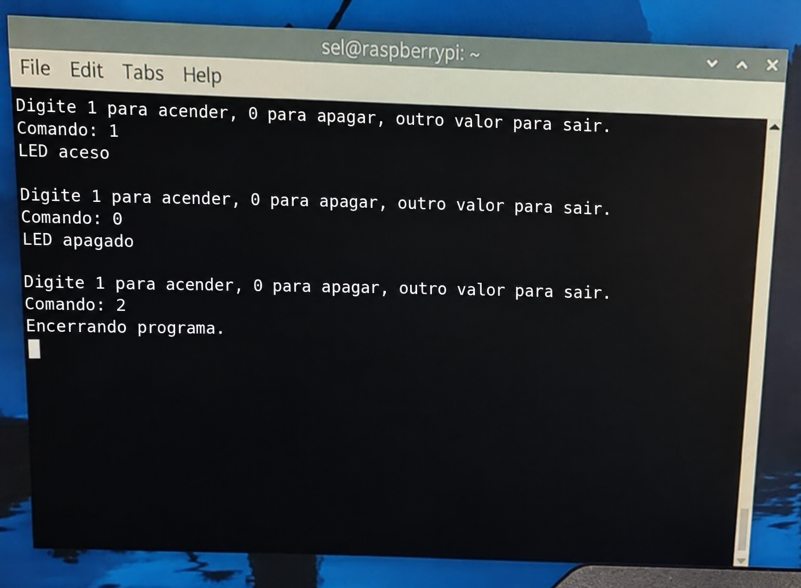

# SEL0337 – Projetos em Sistemas Embarcados
## Prática 4 – Checkpoint 1: Comunicação I2C entre Raspberry Pi e Arduino
 
**Integrantes:**
 
- Gustavo Breda Coelho – NºUSP: 14746742
- Antonio Rosa Garlindo – NºUSP: 15440868
---
 
## 1. Objetivo
 
Estabelecer a comunicação I2C entre uma Raspberry Pi 3B+ e um Arduino Uno (ATmega328P), usando o LED onboard do Arduino (`LED_BUILTIN`) para verificar o recebimento dos comandos.
 
A Raspberry Pi executa um programa em Python (módulo `smbus`) que lê um valor digitado no terminal e o envia ao Arduino por I2C:
 
| Entrada no terminal | Resultado |
|---------------------|-----------|
| `1`                 | LED do Arduino acende |
| `0`                 | LED do Arduino apaga |
| qualquer outro valor | programa é encerrado |
 
## 2. Funcionamento
 
- **Raspberry Pi** – dispositivo *controller* (controlador) do barramento I2C. Lê o teclado e envia um byte ao Arduino.
- **Arduino Uno** – dispositivo *responder* (controlado), com endereço I2C `0x08`. Usa a biblioteca `Wire`: ao receber um byte (`onReceive`), interpreta o comando, altera o estado do `LED_BUILTIN` e imprime no monitor serial o comando recebido e o estado do LED.
O endereço `0x08` é o mesmo nos dois programas.
 
## 3. Montagem
 
A Raspberry Pi opera em 3,3 V e o Arduino em 5 V, por isso foi usado um **conversor de nível lógico bidirecional (level-shifter)** entre as placas.
 
| Sinal I2C | Raspberry Pi | Level-shifter | Arduino |
|-----------|--------------|---------------|---------|
| SDA | GPIO 2 (pino 3) | LVx ↔ HVx | A4 |
| SCL | GPIO 3 (pino 5) | LVx ↔ HVx | A5 |
| Alimentação | 3,3 V (pino 1) | LV | 5 V → HV |
| GND | GND (pino 39) | GND | GND |
 
## 4. Arquivos do repositório
 
| Arquivo | Descrição |
|---------|-----------|
| [`arduino_i2c_led/arduino_i2c_led.ino`](arduino_i2c_led/arduino_i2c_led.ino) | Código C/C++ do Arduino (biblioteca Wire) |
| [`raspberry_i2c_led.py`](raspberry_i2c_led.py) | Script Python da Raspberry Pi (módulo SMBus) |
| `led_on.png`, `led_off.png`, `terminal_raspberry.png` | Imagens do funcionamento |
 
## 5. Como executar
 
**Arduino:** abrir o arquivo `.ino` na Arduino IDE, selecionar a placa Arduino Uno e gravar. O monitor serial (9600 baud) mostra os comandos recebidos.
 
**Raspberry Pi:**
 
1. Habilitar o I2C em `sudo raspi-config` → *Interface Options* → *I2C*.
2. Verificar se o Arduino é detectado (deve aparecer o endereço `08`):
```bash
   sudo i2cdetect -y 1
```
3. Executar o script:
```bash
   python3 raspberry_i2c_led.py
```
 
## 6. Resultados
 
**LED aceso** (comando `1`):
 

 
**LED apagado** (comando `0`):
 

 
**Terminal da Raspberry Pi:**
 

 
## 7. Referências
 
- Documentação da biblioteca [Wire](https://www.arduino.cc/reference/en/language/functions/communication/wire/)
- Roteiro da Prática 4 – SEL0337 (EESC/USP)
